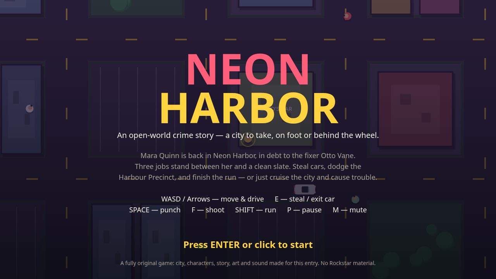

# Neon Harbor

[](https://make.fun/bounty/gta6-01?utm_source=github&utm_medium=readme&utm_campaign=gta6-01)
[](https://make.fun/bounty/gta6-01/leaderboard?utm_source=github&utm_medium=readme&utm_campaign=gta6-01)
[](https://make.fun/bounty/gta6-01?utm_source=github&utm_medium=readme&utm_campaign=gta6-01)

An original open-world crime game for the [make.fun gta6-01 competition](https://make.fun/bounty/gta6-01): explore the port city of Neon Harbor on foot or behind the wheel, steal cars, dodge the Harbour Precinct, and run three story missions for the fixer Otto Vane. Everything — the city, characters, story, art and sound — is original and made for this entry.



## Play

Open `game/index.html` in a desktop browser, or serve it locally (no build step, no network requests while playing):

```sh
node serve.ts
# then open http://localhost:8080
```

## Controls

| Key | Action |
| --- | --- |
| WASD / Arrows | Move on foot, drive when in a car |
| Shift | Run |
| E | Steal / enter a car, exit a car |
| Space | Punch |
| F | Shoot (once you have the pistol) |
| P / Esc | Pause |
| M | Mute |

## The game

- **A city to explore** — Neon Harbor is a 10×10 road grid with named landmarks (Otto's Bar, the Chop Shop, the Gun Shop, St. Marina Hospital, Police HQ, the Safehouse and the docks), parks, parking lots and a harbour pier.
- **On foot and by car** — walk the streets or jack any parked or driven car (the driver bails and runs). Cars have arcade handling, damage, smoke and wrecks.
- **Traffic and pedestrians** — traffic drives the grid, stops for the car ahead and turns at intersections; pedestrians stroll the sidewalks and flee from trouble.
- **Wanted level and police** — crimes raise your heat (1–5 stars). Police cars chase, ram and try to arrest you on foot. Lay low and the heat cools off; get caught and you pay bail.
- **Missions and a story** — three jobs for Otto Vane: steal a car for the Chop Shop, run a hot package from the docks to the bar, then outrun a three-star manhunt to the safehouse. Mission markers, an edge arrow and a distance readout guide you.
- **Combat** — punch pedestrians, run them down, or pick up the pistol at the Gun Shop and shoot.
- **HUD and minimap** — cash, health, wanted stars, car health, speed, ammo, mission objective and a live minimap with police, traffic and the mission marker.
- **Start and save** — start a new game or continue; cash, mission progress and earnings autosave to localStorage.
- **Sound** — a fully synthesized WebAudio soundtrack of engine hum, sirens, punches, gunshots, crashes and mission jingles. No audio files.

## Screenshots

The four screenshots in `screenshots/` are renders of the game itself, taken headlessly from the deterministic `?shot=` scenes (`shots.json`): the title screen, driving downtown, a three-star police chase, and the story-complete screen. Run them again with any `?shot=start|play|chase|end&seed=1` URL — the same seed always renders the same frame.

## Development

The game is plain static files under `game/` (an HTML page and ES modules, no libraries, no network requests). `main.ts` (Node 22, standard library only) copies `game/` and `screenshots/` to the output directory and writes `dossier.json`.

```sh
MAKEFUN_OUTPUT_DIR=out node main.ts
```

Referral: https://make.fun/r/nx2h6gdz

## License

MIT — see [LICENSE](LICENSE).
